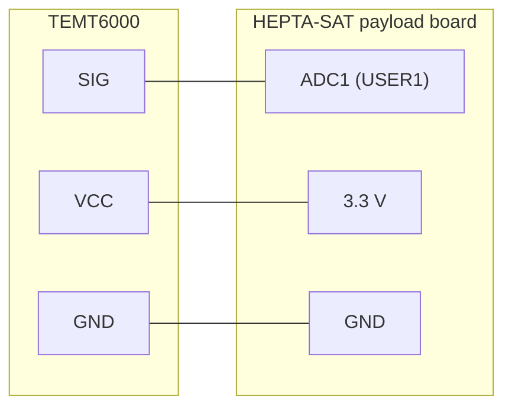

# Lab7-sample_light-sensor

HEPTA-SAT training sample: **SparkFun TEMT6000** ambient light sensor.

## Sensor Specifications

| Item | Value |
|------|-------|
| Part | **TEMT6000** (visible-light phototransistor) |
| Example product | SparkFun SEN-08654, etc. |
| Interface | Analog output → **USER1 / USER2 / USER3** (V4.1.1) |
| Supply | 3.3 V |
| Output | Voltage proportional to light level (higher = brighter) |
| Illuminance | Approx. `lux ≈ voltage [V] × 200` (uncalibrated) |

## Wiring (HEPTA-SAT V4.1.1)

| Sensor | HEPTA-SAT |
|--------|-----------|
| SIG (analog output) | **ADC1** (`USER1` in the sketch) |
| VCC | 3.3 V payload (`eps.switch_3V3_on()`) |
| GND | GND |

The sketch uses `light.begin(USER1)`. For a different connection, use `USER2` for **ADC2** or `USER3` for **ADC3**.



## Build and Upload

1. Open `Lab7-sample_light-sensor.ino` in the Arduino IDE
2. Board: **Generic RP2350**
3. Check out the `src/` submodule (`git submodule update --init`)
4. Compile and upload
5. Serial monitor at **9600 baud**

## Example Serial Output

```
TEMT6000 ready
Voltage: 0.825 [V]
Illuminance (approx): 165.0 [lux]
Voltage: 1.650 [V]
Illuminance (approx): 330.0 [lux]
```

## Driver

- Board interface: `HeptaLightTemt6000` from `src/HeptaSat.h`
- `src/drv/light_temt6000.h` / `.cpp`
- Details: `src/docs/drivers/light-temt6000.md`
